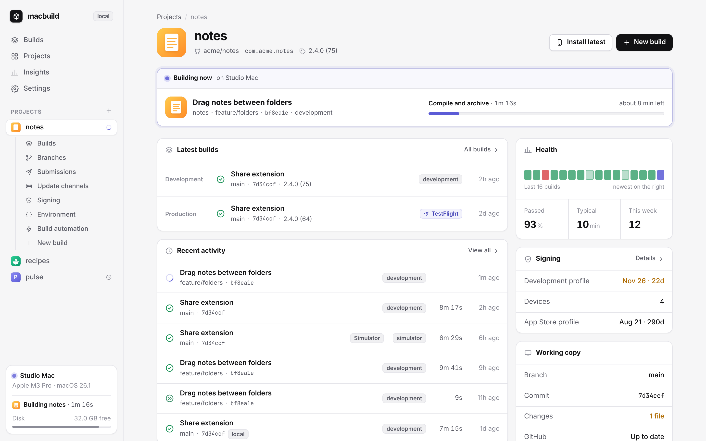
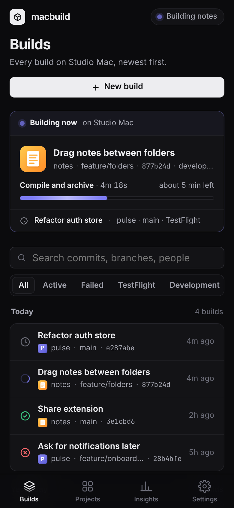
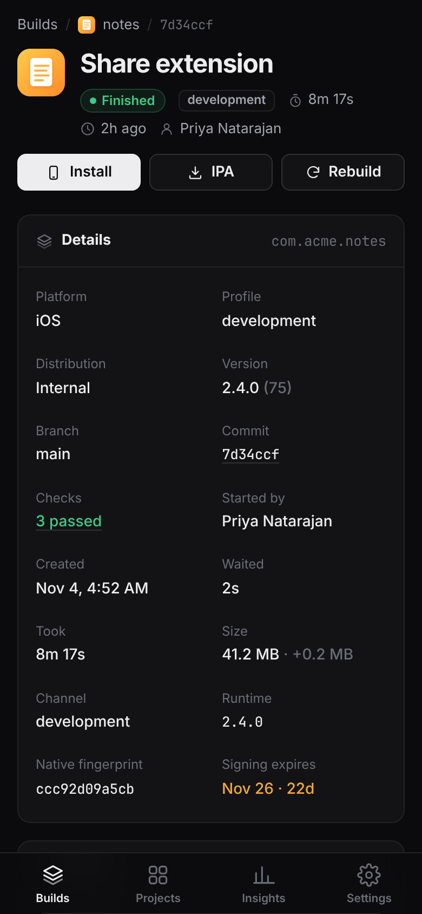
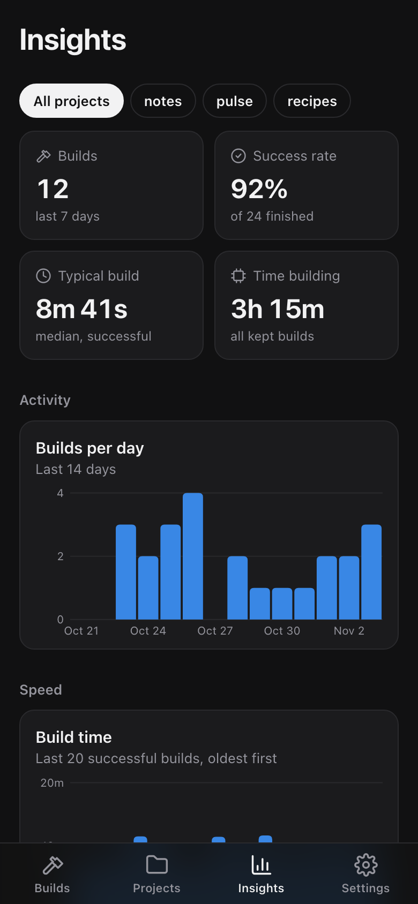

# macbuild

Build your Expo apps for iOS and Android on your own Mac, with an EAS-style dashboard you can use from your phone.

macbuild wraps `eas build --local`: it answers the signing prompts, builds any branch or commit from GitHub in a clean checkout, skips rebuilds when only JavaScript changed, and uploads to TestFlight or Google Play. No build credits, no queue.



<p>
  
  
  
</p>

## Install

```sh
curl -fsSL https://raw.githubusercontent.com/fav-devs/macbuild/main/install.sh | bash
```

With the web UI, and a block on EAS cloud builds:

```sh
curl -fsSL https://raw.githubusercontent.com/fav-devs/macbuild/main/install.sh | bash -s -- --ui --guard
```

The installer finds Expo apps in your usual project folders, then runs `macbuild doctor` to show anything missing. Run the same command again to update.

With `--ui`, the dashboard starts at login and a hammer sits in the menu bar. Walk through the rest in the setup guide:

```sh
macbuild setup            # what's missing, the dashboard URL, login and menu bar
macbuild setup --ui       # dashboard + menu bar
macbuild setup --login    # open at login
macbuild setup --open     # open the guide in the browser
```

Or open `#/setup` on the dashboard. You need a Mac with Xcode, Node.js, CocoaPods, fastlane, `eas-cli` (signed in with `eas login`) and an Apple Developer account. For Android, add Android Studio (for its SDK) and Java 17. GitHub CLI and Tailscale are optional.

### Using an AI agent

Point your agent at this repo:

> Set up macbuild on this Mac by following https://github.com/fav-devs/macbuild/blob/main/AGENTS.md

`macbuild <name>` already waits until that CLI build finishes. For a dashboard job, run `macbuild wait` (or `macbuild wait <id>`). `--json` prints one object when it ends; `--follow` streams the log. `macbuild mcp` is a stdio MCP server with wait, show, builds and log.

## Use

```sh
macbuild myapp                                # dev build from your working copy
macbuild myapp --ref main                     # build what's pushed to GitHub, in a clean checkout
macbuild myapp --install                      # build, then install on the paired iPhone
macbuild myapp --skip-unchanged --install     # rebuild only if native code changed, then install
macbuild myapp --profile simulator --install  # a simulator profile, opened in the iOS Simulator
macbuild myapp --submit --ref main            # production build, uploaded to TestFlight
macbuild myapp --android --install            # Android APK, installed on the phone on adb
macbuild myapp --android --submit --ref main  # Android App Bundle, uploaded to Google Play
macbuild myapp --profile preview --fast       # any eas.json profile, reusing compiled output
```

| Option | What it does |
|---|---|
| `--platform ios\|android` | Which app to build. Default `ios`; `--android` is short for `--platform android`. |
| `--profile NAME` | The `eas.json` build profile. Default `development`, or `production` with `--submit`. A profile with `ios.simulator` builds for the Simulator; on Android, `buildType` or the distribution picks an APK or an AAB. |
| `--ref REF` | Build a pushed branch, tag or commit in a clean checkout. Uncommitted files never go in. |
| `--install` | Install the build: on the iPhone set in `MACBUILD_DEVICE`, in the iOS Simulator for a simulator profile, or on the Android phone connected with USB debugging. |
| `--screenshot PATH` | With `--install` on the Simulator, save a screenshot of the app once it's open. |
| `--skip-unchanged` | Reuse the last build of this profile when the native code hasn't changed. macbuild compares fingerprints from the project's own `@expo/fingerprint`. Meant for development and simulator builds, which load JavaScript from Metro. |
| `--submit` | Upload to TestFlight or Google Play after the build, with the `eas.json` submit profile named like the build profile, or `production`. `--testflight` still works. |
| `--send` | Send the build to the device set in `MACBUILD_TAILDROP_TARGET` with Taildrop. |
| `--fast` | Keep one work folder per app and profile and turn on Xcode's compilation cache, so later builds reuse compiled output. |
| `--output PATH` | Where the build goes. Default: your Desktop. |

When a build fails, macbuild prints the likely cause and how to fix it if it recognises the error: a device missing from the provisioning profile, a CocoaPods conflict, an expired certificate, the wrong Java for Gradle, and more.

Managing projects:

```sh
macbuild list                                # your projects
macbuild add myapp ~/code/myapp/apps/mobile  # the folder with eas.json; in a monorepo, the app's folder
macbuild scan                                # find Expo apps in ~/Documents, ~/Developer, ~/Projects, ~/code and ~/src
macbuild commit myapp --push                 # split local git changes with T3, then push
macbuild wait                                # block until the latest dashboard job finishes
macbuild wait myapp --json                   # same, as one JSON object
macbuild mcp                                 # stdio MCP: wait, show, builds, log
macbuild doctor                              # check the tools and logins builds need
macbuild setup                               # dashboard, login, menu bar, and the same checks
```

Project names use letters, digits, `.`, `_` and `-`.

## Settings

Optional, in `~/.config/macbuild/env`. The file stays on your Mac; never commit it.

| Setting | What it's for |
|---|---|
| `MACBUILD_APPLE_ID` | Your Apple ID, so builds don't stop to ask for it. |
| `MACBUILD_APPLE_PASSWORD_FILE` | A file holding that Apple ID's password. Leave both empty to use EAS's saved session. |
| `MACBUILD_DEVICE` | The iPhone for `--install`, from `xcrun devicectl list devices`. |
| `MACBUILD_TAILDROP_TARGET` | The Tailscale device name for `--send`. |
| `MACBUILD_NODE` | The nvm Node version to build with, such as `v22.17.0`. Default: the `node` on your PATH. |
| `MACBUILD_SIMULATOR` | The simulator for `--install`, by name or UDID. Default: the booted one, or the first iPhone. |
| `MACBUILD_ANDROID_DEVICE` | The Android phone for `--install` when several are connected, from `adb devices`. |
| `ANDROID_HOME`, `JAVA_HOME` | The Android SDK and Java 17, only if they aren't where Android Studio puts them. |

## Web UI

Install with `--ui` to run the dashboard at login, at `http://localhost:4180` on the Mac, with a menu bar extra for build status and a one-click build. Turn those off under Settings, or with `macbuild setup --nologin` and `--no-menubar`. With Tailscale the dashboard is also published on your tailnet only, at `https://<your-mac>.<tailnet>.ts.net:8443`. Open that in Safari on your iPhone and add it to your Home Screen. The setup guide at `#/setup` copies that URL.

- Start iOS, Simulator and Android builds from any branch, commit and `eas.json` profile, and reuse the last one when native code hasn't changed
- When the working copy has local git changes a GitHub build would skip, split them into commits and push through T3 Code so unrelated files stay apart
- Follow a build live: its current phase, the time left going by your usual build time, and logs grouped by phase on a timeline
- See commit, PR, GitHub checks, version, channel, app size and its change, signing expiry and who started it for each build
- When a build fails, the likely cause and how to fix it
- Install dev builds on an iPhone over the air or by QR code, put them on a paired iPhone from this Mac (Wi-Fi or always), download Android APKs, or open Simulator builds in the Simulator on the Mac
- Build automatically on every push, for each pull request, or every night; a newer push replaces a build that hasn't started
- Post each build's status to its commit on GitHub, and a message to Slack or Discord
- A page for each project's builds, branches, submissions, update channels, signing and devices, environment variable names, and build automation, with Expo's data read-only
- Charts for build activity, speed, success rate, app size and where the time goes
- Disk cleanup for Xcode's build files, caches, old simulators and macbuild's own work folders
- Your app's icon from `app.json`, your Mac's status in the sidebar, and push notifications when a build finishes

Installing from the page needs HTTPS, which Tailscale provides, and a device in the app's provisioning profile.

A few things the dashboard reads:

- **App icons** come from `expo.ios.icon` or `expo.icon` in `app.json`. Apps configured only with `app.config.js` or `app.config.ts` get a monogram instead.
- **Registered devices** on a project's Signing page need your Apple Team ID. Enter it under Settings, Integrations.
- **PR and CI details, pull request builds and GitHub statuses** need the GitHub CLI, signed in with `gh auth login`. Pull requests from forks are never built: their code would run on your Mac.
- **Slack or Discord**: paste an incoming webhook URL under Settings, Integrations. The dashboard shows only its host afterwards.
- **Who started a build** comes from Tailscale, which tells the dashboard who is signed in on each device in your tailnet.
- **Other ports:** set `MACBUILD_UI_PORT` (default 4180) or `MACBUILD_UI_HTTPS_PORT` (default 8443) when you run the installer with `--ui`.

## Security

**The web UI has no login.** Anyone who can reach it can start builds and download your IPAs. It listens on `127.0.0.1` and is meant to be shared only through your private tailnet. Never put it on the public internet, and don't turn on Tailscale Funnel for it. It answers only requests addressed to `localhost`, `127.0.0.1` or a `*.ts.net` name, which stops other websites from reaching it through DNS rebinding. To use another name, list it in `MACBUILD_UI_HOSTS` (comma-separated) in `~/Library/LaunchAgents/local.macbuild.ui.plist`.

Signing credentials stay with EAS and your Mac. Your Apple password, if you set one, is read from a file you choose. Environment variable values never reach the UI.

## Good to know

- Builds run one at a time and use your whole Mac. A build started while another is running, from the terminal, an agent or the web UI, waits for it.
- The first build of a new app can stop at a signing question macbuild doesn't answer. If its log stops moving, run `eas credentials` once in a terminal, then build again.
- `--submit` uses `eas submit`, so Expo's servers do the upload to Apple or Google. The build itself is local, and the store still has to process the build before testers get it.
- macbuild still uses your Expo account for credentials and project settings. It replaces EAS's build machines, not the rest of EAS.
- `--guard` wraps the global `eas` command so `eas build` needs `--local`, and `eas build:dev`, `build:resign` and `workflow:run` are refused. It doesn't stop `npx eas-cli`. Remove it with `install.sh --unguard`, and run `--guard` again after updating `eas-cli`.

## Files

| Path | What's there |
|---|---|
| `~/.config/macbuild/projects.conf` | Your projects, one `name\|path` per line |
| `~/.config/macbuild/env` | The settings above |
| `~/.config/macbuild/ui.json` | Web UI automatic-build rules, notification keys, webhook and `appleTeam` |
| `~/.local/share/macbuild/fingerprints` | The native fingerprint of each build, for `--skip-unchanged` |
| `~/.local/share/macbuild/builds` | Web UI build history: the last 200 builds, with IPAs for the last 10 |
| `~/.cache/macbuild` | Work folders and checkouts. Safe to delete between builds. |
| `~/Library/Logs/<name>-<platform>-build-<profile>.log` | The log of the last terminal build of each app, platform and profile |
| `~/Library/Logs/macbuild-ui.log` | The web UI's own log |
| `~/Library/Logs/macbuild-menubar.log` | The menu bar extra |
| `~/.local/share/macbuild/macbuild-menubar.app` | Menu bar extra (compiled on this Mac) |
| `~/.local/bin/macbuild-menubar` | Symlink to that app’s binary |

## Uninstall

```sh
curl -fsSL https://raw.githubusercontent.com/fav-devs/macbuild/main/install.sh | bash -s -- --uninstall
```

This removes the command, the `eas` wrapper, the web UI service and `~/.cache/macbuild`. It keeps your settings and build history; delete `~/.macbuild`, `~/.config/macbuild` and `~/.local/share/macbuild` to clear everything.

## Develop

```sh
git clone https://github.com/fav-devs/macbuild.git && cd macbuild
npm ci --prefix ui
node ui/demo/demo.mjs        # the dashboard with sample projects and a build running, at http://localhost:4181
node --test test/*.test.mjs  # tests for the CLI and the web UI's server
```

The demo uses stand-ins for `eas`, `gh` and GitHub, so it runs on any machine and never touches your projects. The screenshots above come from it. CI runs the tests on Linux and macOS, plus `shellcheck` on the scripts. [AGENTS.md](AGENTS.md) has notes on how the pieces fit together.

## License

MIT. Not affiliated with Expo or Apple.
