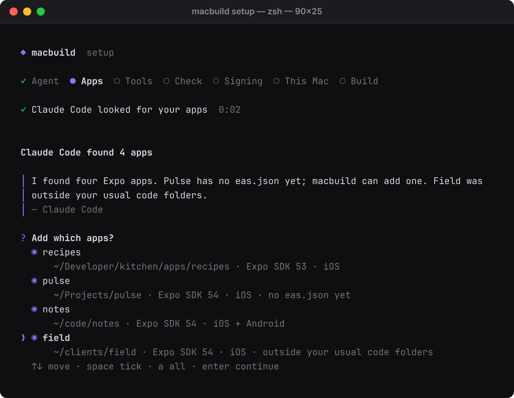
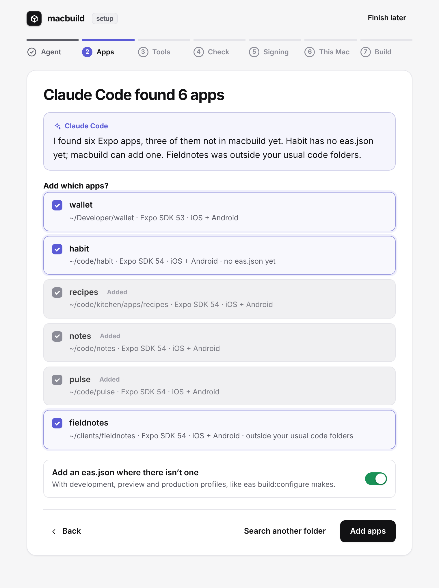
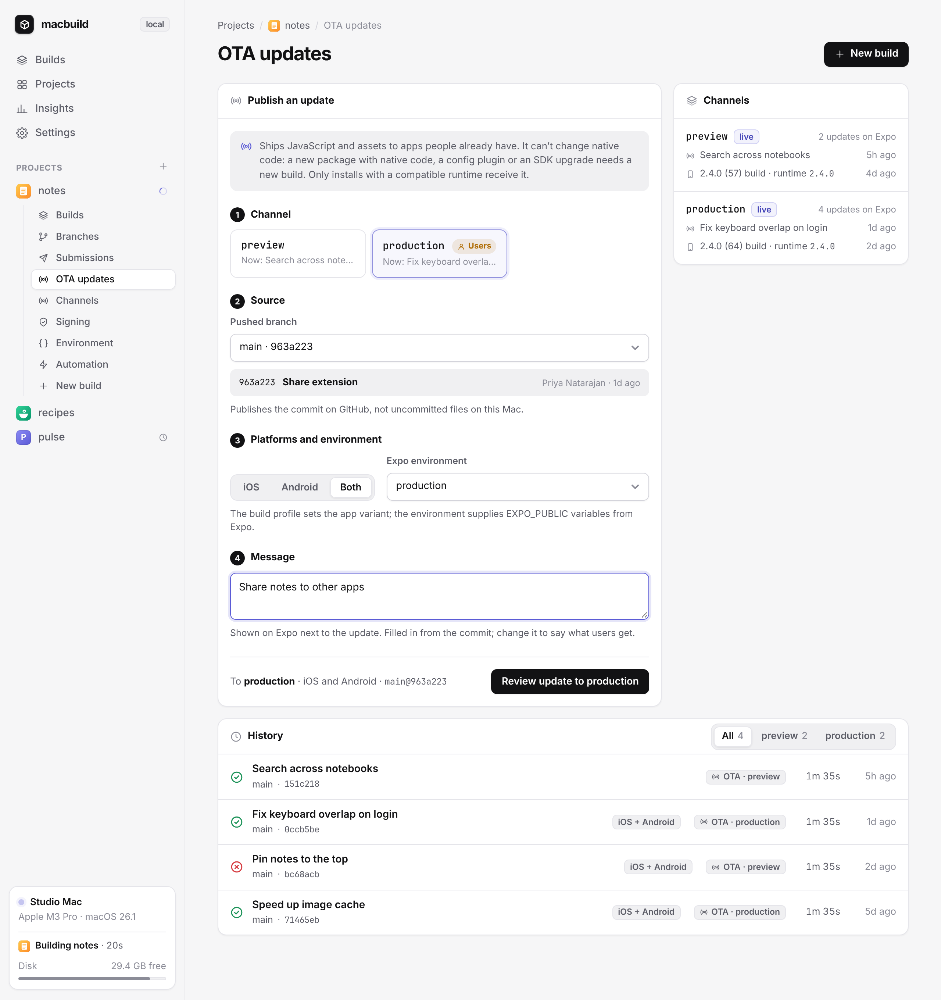
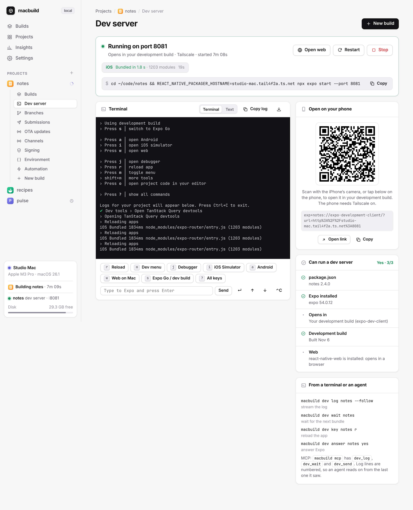

# macbuild

Build your Expo apps for iOS and Android on your own Mac, with an EAS-style dashboard you can use from your phone.

macbuild wraps `eas build --local`: it answers the signing prompts, builds any branch or commit from GitHub in a clean checkout, skips rebuilds when only JavaScript changed, and uploads to TestFlight or Google Play. No build credits, no queue.

It also runs each app's Expo dev server. Start Metro from your phone, open the app with a QR code, and press Expo's keys from the dashboard. Agents can watch the same log and wait for the next bundle after they change code.


<p>
  
  
  
</p>

## Install

For Windows/Linux clients connecting to a Mac, see [Remote builds](#remote-builds-windows-linux-and-other-macs). The native build worker still runs on macOS.

```sh
curl -fsSL https://raw.githubusercontent.com/fav-devs/macbuild/main/install.sh | bash
```

With the web UI, and a block on EAS cloud builds:

```sh
curl -fsSL https://raw.githubusercontent.com/fav-devs/macbuild/main/install.sh | bash -s -- --ui --guard
```

Run the same command again to update. With `--ui`, the dashboard starts at login and a hammer sits in the menu bar.

You need a Mac with Xcode, Node.js, CocoaPods, fastlane, `eas-cli` (signed in with `eas login`) and an Apple Developer account. For Android, add Android Studio (for its SDK) and Java 17. GitHub CLI and Tailscale are optional.

### First-time setup

In a terminal, the installer ends with the guided setup. It asks whether to carry on in the terminal or in the browser, then walks through eight steps:

<p>
  
  
</p>

1. **Agent.** Pick Claude Code or Codex if you have one. It works in the background, read-only: Claude Code gets only its Read, Glob and Grep tools, and Codex runs in its read-only sandbox. Both follow [the setup skill](skills/macbuild-setup/SKILL.md).
2. **Apps.** The agent looks for Expo and React Native apps, in your usual code folders and beyond, and reads each one. You tick the ones to add, or point it at another folder.
3. **Tools.** `macbuild doctor`, with the command for each missing tool ready to run.
4. **Check.** Anything that would make EAS stop and ask during a build: no bundle identifier, no EAS project, no development profile, no `expo-dev-client`. Each fix is listed for you to approve, with a suggested value you can change. macbuild makes the change, from a fixed list of fixes it knows; the agent never edits anything.
5. **Signing.** `eas credentials:configure-build` for each app, in a terminal, where you sign in to Apple yourself. macbuild and the agent never see your password.
6. **This Mac.** The dashboard at login, the iPhone for `--install` and your Apple ID.
7. **Phone.** Tailscale, so the dashboard opens on your phone and stays private to your tailnet: install it, sign in, and publish the dashboard with `tailscale serve`. Then a link and a QR code for your iPhone. Skip it to keep the dashboard on the Mac only.
8. **First build.** A development build of the app you pick.

Without an agent, macbuild's own scan and checks do steps 2 and 4. Setup remembers where you got to, in the terminal and the browser alike.

```sh
macbuild setup             # the guided setup: in this terminal, or in the browser
macbuild setup --cli       # straight to the terminal; --web for the browser
macbuild setup --agent codex   # pick the agent up front: claude, codex or none; --reset starts over
macbuild setup --status    # what's set up and what's missing, for scripts and agents
macbuild setup --ui        # dashboard + menu bar + Tailscale Serve
macbuild setup --tailscale # start Tailscale and publish the dashboard on the tailnet
macbuild setup --login     # open at login
macbuild setup --open      # open the setup page in the browser
```

The first time you run plain `macbuild`, it offers the same setup. In the browser it's the dashboard's `#/setup` page; if the dashboard isn't installed yet, `macbuild setup --web` serves it until you finish, then installs it if you asked for that.

### Using an AI agent

Point your agent at this repo:

> Set up macbuild on this Mac by following https://github.com/fav-devs/macbuild/blob/main/AGENTS.md

`macbuild <name>` already waits until that CLI build finishes, and the dashboard lists it with the rest. For a job that's already running, run `macbuild wait` (or `macbuild wait <id>`). `--json` prints one object when it ends; `--follow` streams the log. `macbuild mcp` is a stdio MCP server with wait, show, builds and log. `macbuild ask` sends a failed build to T3 Code in that app’s folder. The dashboard Settings page lists T3’s signed-in agents; `--codex` or `--model` override the default.

## Use

```sh
macbuild myapp                                # dev build from your working copy
macbuild myapp --ref main                     # build what's pushed to GitHub, in a clean checkout
macbuild myapp --install                      # build, then install on the paired iPhone
macbuild myapp --skip-unchanged --install     # rebuild only if native code changed, then install
macbuild myapp --profile simulator --install  # a simulator profile, opened in the iOS Simulator
macbuild myapp --submit --ref main            # production build, uploaded to TestFlight
macbuild myapp --android --install            # Android APK, installed on the phone on adb
macbuild myapp --android --submit --ref main  # Android App Bundle, uploaded to Google Play
macbuild myapp --profile preview --fast       # any eas.json profile, reusing compiled output
```

| Option | What it does |
|---|---|
| `--platform ios\|android` | Which app to build. Default `ios`; `--android` is short for `--platform android`. |
| `--profile NAME` | The `eas.json` build profile. Default `development`, or `production` with `--submit`. A profile with `ios.simulator` builds for the Simulator; on Android, `buildType` or the distribution picks an APK or an AAB. |
| `--ref REF` | Build a pushed branch, tag or commit in a clean checkout. Uncommitted files never go in. |
| `--install` | Install the build: on the iPhone set in `MACBUILD_DEVICE`, in the iOS Simulator for a simulator profile, or on the Android phone connected with USB debugging. |
| `--screenshot PATH` | With `--install` on the Simulator, save a screenshot of the app once it's open. |
| `--skip-unchanged` | Reuse the last build of this profile when the native code hasn't changed. macbuild compares fingerprints from the project's own `@expo/fingerprint`. Meant for development and simulator builds, which load JavaScript from Metro. |
| `--submit` | Upload to TestFlight or Google Play after the build, with the `eas.json` submit profile named like the build profile, or `production`. `--testflight` still works. |
| `--submit-only PATH` | Upload an existing store IPA or AAB without rebuilding. Uses configured submission credentials noninteractively. |
| `--send` | Send the build to the device set in `MACBUILD_TAILDROP_TARGET` with Taildrop. |
| `--fast` | Keep one work folder per app and profile and turn on Xcode's compilation cache, so later builds reuse compiled output. |
| `--output PATH` | Where the build goes. Default: your Desktop. |

Completed store builds have a **Submit to TestFlight** or **Submit to Google Play** action on their dashboard build page. Confirming uploads the retained artifact without rebuilding, with a separate job for logs and status. Uploads run alongside local builds without taking the build lock; submissions use their own single-job queue. Development, internal, simulator, expired, and APK builds are not eligible. Configure submission credentials once in a terminal if the upload reports missing credentials. Stopping the local submission job does not retract an upload already scheduled with Expo.

When a build fails, macbuild prints the likely cause and how to fix it if it recognises the error: a device missing from the provisioning profile, a CocoaPods conflict, an expired certificate, the wrong Java for Gradle, and more. Send that log to T3 Code in the project folder with `macbuild ask`. The dashboard Settings page lists T3’s signed-in agents; `--codex` or `--model` override the default.

Managing projects:

```sh
macbuild list                                # your projects
macbuild add myapp ~/code/myapp/apps/mobile  # the folder with eas.json; in a monorepo, the app's folder
macbuild scan                                # find Expo apps in ~/Documents, ~/Developer, ~/Projects, ~/code and ~/src
macbuild commit myapp --push                 # split local git changes with T3, then push
macbuild wait                                # block until the latest dashboard job finishes
macbuild wait myapp --json                   # same, as one JSON object
macbuild mcp                                 # stdio MCP: wait, show, builds, log, and the dev server tools
macbuild dev                                 # each app: can it run a dev server, is one running, its link
macbuild dev myapp                           # start its dev server (npx expo start), wait until Metro is ready
macbuild doctor                              # check the tools and logins builds need
macbuild setup                               # the guided setup; --status for what's set up and missing
```

Project names use letters, digits, `.`, `_` and `-`.

## Settings

Optional, in `~/.config/macbuild/env`. The file stays on your Mac; never commit it.

| Setting | What it's for |
|---|---|
| `MACBUILD_APPLE_ID` | Your Apple ID, so builds don't stop to ask for it. |
| `MACBUILD_APPLE_PASSWORD_FILE` | A file holding that Apple ID's password. Leave both empty to use EAS's saved session. |
| `MACBUILD_DEVICE` | The iPhone for `--install`, from `xcrun devicectl list devices`. |
| `MACBUILD_TAILDROP_TARGET` | The Tailscale device name for `--send`. |
| `MACBUILD_NODE` | The nvm Node version to build with, such as `v22.17.0`. Default: the `node` on your PATH. |
| `MACBUILD_SIMULATOR` | The simulator for `--install`, by name or UDID. Default: the booted one, or the first iPhone. |
| `MACBUILD_ANDROID_DEVICE` | The Android phone for `--install` when several are connected, from `adb devices`. |
| `ANDROID_HOME`, `JAVA_HOME` | The Android SDK and Java 17, only if they aren't where Android Studio puts them. |

## Web UI

Install with `--ui` to run the dashboard at login, at `http://localhost:4180` on the Mac, with a menu bar extra for build status and a one-click build. Turn those off under Settings, or with `macbuild setup --nologin` and `--no-menubar`. With Tailscale the dashboard is also published on your tailnet only, at `https://<your-mac>.<tailnet>.ts.net:8443`. Open that in Safari on your iPhone and add it to your Home Screen. Setup's Phone step gets Tailscale ready and shows that link with a QR code.

- Start iOS, Simulator and Android builds from any branch, commit and `eas.json` profile, and reuse the last one when native code hasn't changed
- When the working copy has local git changes a GitHub build would skip, split them into commits and push through T3 Code so unrelated files stay apart
- Follow a build live: its current phase, the time left going by your usual build time, and logs grouped by phase on a timeline
- See commit, PR, GitHub checks, version, channel, app size and its change, signing expiry and who started it for each build
- When a build fails, the likely cause and how to fix it
- Install dev builds on an iPhone over the air or by QR code, put them on a paired iPhone from this Mac (Wi-Fi or always), download Android APKs, or open Simulator builds in the Simulator on the Mac
- Build automatically on every push, for each pull request, or every night; a newer push replaces a build that hasn't started
- Post each build's status to its commit on GitHub, and a message to Slack or Discord
- A page for each project's builds, branches, submissions, update channels, signing and devices, environment variable names, and build automation, with Expo's data read-only
- Run each app's Expo dev server: start and stop it, open it on your phone with a QR code or in a browser, follow Expo's terminal live, press its keys and answer its questions
- Charts for build activity, speed, success rate, app size and where the time goes
- Disk cleanup for Xcode's build files, caches, old simulators and macbuild's own work folders
- Your app's icon from `app.json`, your Mac's status in the sidebar, and push notifications when a build finishes

Installing from the page needs HTTPS, which Tailscale provides, and a device in the app's provisioning profile.

A few things the dashboard reads:

- **App icons** come from `expo.ios.icon` or `expo.icon` in `app.json`. Apps configured only with `app.config.js` or `app.config.ts` get a monogram instead.
- **Registered devices** on a project's Signing page need your Apple Team ID. Enter it under Settings, Integrations.
- **PR and CI details, pull request builds and GitHub statuses** need the GitHub CLI, signed in with `gh auth login`. Pull requests from forks are never built: their code would run on your Mac.
- **Slack or Discord**: paste an incoming webhook URL under Settings, Integrations. The dashboard shows only its host afterwards.
- **Who started a build** comes from Tailscale, which tells the dashboard who is signed in on each device in your tailnet.
- **Other ports:** set `MACBUILD_UI_PORT` (default 4180) or `MACBUILD_UI_HTTPS_PORT` (default 8443) when you run the installer with `--ui`.

## Security

**The web UI has no login.** Anyone who can reach it can start builds, run dev servers and press their keys, and download your IPAs. It listens on `127.0.0.1` and is meant to be shared only through your private tailnet. Never put it on the public internet, and don't turn on Tailscale Funnel for it. It answers only requests addressed to `localhost`, `127.0.0.1` or a `*.ts.net` name, which stops other websites from reaching it through DNS rebinding. To use another name, list it in `MACBUILD_UI_HOSTS` (comma-separated) in `~/Library/LaunchAgents/local.macbuild.ui.plist`.

Signing credentials stay with EAS and your Mac. Your Apple password, if you set one, is read from a file you choose. Environment variable values never reach the UI.

## Good to know

- Builds run one at a time and use your whole Mac. A build started while another is running, from the terminal, an agent or the web UI, waits for it.
- The first build of a new app can stop at a signing question macbuild doesn't answer. If its log stops moving, run `eas credentials` once in a terminal, then build again.
- `--submit` uses `eas submit`, so Expo's servers do the upload to Apple or Google. The build itself is local, and the store still has to process the build before testers get it.
- macbuild still uses your Expo account for credentials and project settings. It replaces EAS's build machines, not the rest of EAS.
- `--guard` wraps the global `eas` command so `eas build` needs `--local`, and `eas build:dev`, `build:resign` and `workflow:run` are refused. It doesn't stop `npx eas-cli`. Remove it with `install.sh --unguard`, and run `--guard` again after updating `eas-cli`.

## Files

| Path | What's there |
|---|---|
| `~/.config/macbuild/projects.conf` | Your projects, one `name\|path` per line |
| `~/.config/macbuild/env` | The settings above |
| `~/.config/macbuild/ui.json` | Web UI automatic-build rules, notification keys, webhook and `appleTeam` |
| `~/.config/macbuild/setup.json` | How far setup got, what it found, and which signing commands finished |
| `~/.local/share/macbuild/fingerprints` | The native fingerprint of each build, for `--skip-unchanged` |
| `~/.local/share/macbuild/builds` | Web UI build history: the last 200 builds, with IPAs for the last 10 |
| `~/.local/share/macbuild/dev` | Dev server logs: the last 20 sessions of each app, and how each was started |
| `~/.cache/macbuild` | Work folders and checkouts. Safe to delete between builds. |
| `~/Library/Logs/<name>-<platform>-build-<profile>.log` | The log of the last terminal build of each app, platform and profile |
| `~/Library/Logs/macbuild-ui.log` | The web UI's own log |
| `~/Library/Logs/macbuild-menubar.log` | The menu bar extra |
| `~/.local/share/macbuild/macbuild-menubar.app` | Menu bar extra (compiled on this Mac) |
| `~/.local/bin/macbuild-menubar` | Symlink to that app’s binary |

## Uninstall

```sh
curl -fsSL https://raw.githubusercontent.com/fav-devs/macbuild/main/install.sh | bash -s -- --uninstall
```

This removes the command, the `eas` wrapper, the web UI service and `~/.cache/macbuild`. It keeps your settings and build history; delete `~/.macbuild`, `~/.config/macbuild` and `~/.local/share/macbuild` to clear everything.

## Remote builds: Windows, Linux, and other Macs

The same Mac can now act as a build worker. A dependency-light Node CLI sends authenticated jobs to the existing dashboard server; Windows and Linux do not need Xcode, Bash, Apple credentials, or EAS installed. The Mac keeps its signing credentials and runs **local** EAS builds. Remote jobs, source commits, requester names, logs, and artifacts appear in the existing UI.

This repository includes an npm package, `@fav-devs/macbuild` (Node 22+). **It is not published by this change.** Build a local installable package with `npm pack`, transfer the `.tgz` privately to the client, then install it:

```sh
npm install -g ./fav-devs-macbuild-0.2.0.tgz
```

After the maintainer publishes the package, the equivalent is `npm install -g @fav-devs/macbuild`. No install scripts execute automatically. Existing shell installations on the Mac continue to work.

### Connect a client

1. On the Mac, complete the normal `macbuild setup --ui`, Expo login, signing setup, and project registration. Verify a local build works first. The dashboard must be reachable from the client over HTTPS, normally through Tailscale.
2. On the Mac, create a separately revocable token for each client. Start with development builds only:

   ```sh
   macbuild server token create --name windows-agent \
     --projects parley,less --profiles development --scopes read,build,cancel
   ```

   Add `dev` to the scopes to let the client start, stop and press keys in the Mac's dev servers. `read` alone lets it follow their logs.

   This prints a token **once**. Treat it as a password, transfer it privately, and never put it in chat, Git, or an agent prompt. The Mac stores only its hash. Tokens expire after 90 days by default (`--expires-days 1` through `365`). Administer them locally with `macbuild server token list` and `macbuild server token revoke ID`; revocation does not stop jobs already launched.
3. On Windows, put only the token value in a temporary private file, then run PowerShell:

   ```powershell
   Get-Content -Raw .\macbuild-token.txt | macbuild remote add home-mac https://your-mac.ts.net:8443 --token-stdin
   Remove-Item .\macbuild-token.txt
   macbuild doctor
   macbuild list
   ```

   Restrict the client config (`~/.config/macbuild/remotes.json`) to your Windows account using NTFS ACLs. On Unix it is written with mode `0600`. If PowerShell blocks npm's script shim, invoke `macbuild.cmd` instead. Use `macbuild remote list`, `remote use NAME`, or `remote remove NAME` to manage connections. `--remote NAME` overrides the default and `--local` explicitly selects the Mac worker. A failed remote connection **never** falls back to running locally.

For CI, inject `MACBUILD_SERVER_URL` and secret `MACBUILD_TOKEN` instead of storing a client config. Connections require valid HTTPS certificates; there is no insecure-TLS option. Plain HTTP is accepted only for loopback testing.

### Source and release gates

Run from the app's local Git checkout on the client:

```sh
macbuild source
macbuild commits parley --ref main
git add src/the-file-you-changed.ts
git commit -m "Fix keyboard layout"
macbuild push --confirm-push
macbuild parley --profile development --wait --json
```

- **No automatic staging, committing, or pushing.** `push --confirm-push` pushes the clean current branch without force; rejected or divergent pushes remain rejected. Use Git for commit selection and history review.
- By default, dirty files, unpushed HEAD commits, and a local HEAD that differs from origin block a job. `--ref main --allow-dirty` intentionally builds only that pushed source, excluding local changes. Detached HEAD needs an explicit `--ref`.
- Client and server origins must identify the same HTTPS/SSH repository. The server fetches origin, verifies the exact commit is reachable from an origin branch, and rejects a moved branch. It always queues the pinned SHA, never the Mac's dirty working copy. No source ZIPs, arbitrary shell commands, or remote project-path registration are accepted.
- Tokens have explicit project, profile, and action allowlists. Scopes are `read`, `build`, `update`, `submit`, and `cancel`. Use `read` alongside mutation scopes for monitoring. No wildcard project/profile permissions.
- To require GitHub CI, add `--required-checks "tests,typecheck"` when issuing a token. The Mac's authenticated `gh` must be able to read check runs/statuses. Each named check must succeed for the exact SHA. Missing, pending, failed, or unreadable checks block queueing. This checks reported results, not branch-protection or workflow-author trust; configure those in GitHub as well.
- OTA/store releases additionally require `--confirm-release` and the relevant token scope. For example, issue a separate release token with `--profiles production --scopes read,build,update,submit`. macbuild never requests an Apple password from the remote client; first-time credentials and unexpected signing prompts must be resolved on the Mac.

```sh
macbuild update parley --profile production --channel production \
  --environment production --platform ios --ref main \
  --message "Fix keyboard suggestions" --confirm-release
macbuild submit BUILD_ID --confirm-release
macbuild builds parley
macbuild show BUILD_ID
macbuild log BUILD_ID --tail 100
macbuild wait BUILD_ID --follow --timeout 1800
macbuild download BUILD_ID --output ./app.ipa
macbuild cancel BUILD_ID
```

Remote job commands return JSON and queue without waiting unless `--wait` is passed. `wait` returns exit `0` for success/skipped, `1` for failed/cancelled, or `124` for timeout. Disconnecting or reaching a wait timeout does not cancel the Mac job. Downloading never overwrites an existing file. Store submission can reuse a retained artifact built from pushed source; no rebuild is needed. Remote OTA and submissions retain the existing separate upload queue.

Creation requests have persisted per-token idempotency keys. To safely retry after losing a response, reuse the reported `--request-id` with identical arguments; a different payload is rejected. A successful retry returns the existing job. Keep job history for the retry period; deleting history removes this record. Mutation attempts by authenticated clients are logged to `~/.config/macbuild/remote-server.json.audit.jsonl`, without raw tokens. Review and rotate this log as needed.

**Network trust:** this is a personal, trusted-tailnet worker, not a public multi-tenant build service. Remote token scopes apply to `/api/remote/v1`; the existing dashboard remains trusted-tailnet access. Anyone allowed to reach the dashboard directly has its existing UI capabilities, independent of token scopes. Use Tailscale ACLs and do not share dashboard access with untrusted users. Authorized repository code executes on the Mac with the worker's account permissions; tokens are not an execution sandbox.

### Remote MCP for agents

Configure the agent on the client with a stdio MCP server after connecting its remote. Set the MCP working directory to the app's checkout:

```json
{
  "mcpServers": {
    "macbuild": {
      "command": "macbuild",
      "args": ["--remote", "home-mac", "mcp"]
    }
  }
}
```

Tools include `projects`, `commits`, `source`, `build`, `update`, `submit`, `builds`, `show`, `log`, `wait`, and `cancel`, plus the [dev server tools](#dev-servers). Build tools use the client's working directory and the same source gates as the CLI. Release tools require `confirmRelease: true` **and** token permission; agents must obtain the user's release request rather than infer approval. A long `wait` does not block other MCP requests. The existing local `macbuild mcp` remains available with `--local` on the Mac.

## OTA updates



Open a project and choose **Push OTA** (or **OTA updates** in its sidebar). Publishing takes four steps:

1. **Channel.** Each channel's card shows the update it has now. Production is marked, since that's where your users are.
2. **Source.** A pushed branch, with the commit that would ship: its hash, subject, author and age.
3. **Platforms and environment.** iOS, Android or both, and the Expo environment that supplies `EXPO_PUBLIC` variables.
4. **Message.** Filled in from the commit; change it to say what users get.

You review the update on the page before it goes out. A production update gets a warning-coloured confirmation that says who receives it and that it can't be taken back from phones that already have it.

Beside the form, **Channels** shows for each channel the last update from this Mac, the newest build that receives it and its runtime, and Expo's update count. Below, the history lists every publish with its commit and status, filterable by channel. Each OTA publish has its own live log. OTA and store uploads share a queue independent of local builds.

Agents and terminal users can publish the same way:

```sh
macbuild update parley --profile production --channel production \
  --environment production --platform ios --ref main \
  --message "Fix keyboard suggestions"
macbuild show parley
macbuild log parley
```

`macbuild ota` is an alias for `macbuild update`. A message, channel, and pushed `--ref` are required. The profile defaults to `production`; platform defaults to `all`. The Expo environment can be inherited from the profile or a standard channel name, but custom channels require an explicit environment. The chosen profile must declare the destination channel; its inherited `env` values supply app-variant settings. Expo environment variables are loaded with `eas update --environment`; ignored local `.env` files are not copied into OTA checkouts.

Publishing uses a separate checkout of a commit reachable from an origin branch, so uncommitted files do not ship and the original project is not modified. No native build or store submission runs. Projects need `expo-updates` configured and an installed release with a matching channel and compatible runtime. JavaScript and asset changes can ship OTA; native module, configuration, or runtime changes may require a new local build. A successful publish does not mean every installed app has already downloaded it. Stopping a publish does not roll back an update already accepted by Expo.

The CLI blocks until publication finishes and records the result in the same history used by `macbuild builds`, `show`, `log`, and the MCP read tools. For dashboard publishes, agents can use `macbuild wait <id>` rather than polling.

## Dev servers



Each project has a **Dev server** page. The dashboard runs `npx expo start` for the app on the Mac, in a terminal it holds, so you can start Metro from your phone and close the laptop. The projects page shows, for every app, whether it can run one and whether one is running.

- **Can it run?** The page checks that the app has `expo` in `package.json` and installed. If the dependencies are missing, it shows the install command for the app's package manager, at the workspace root in a monorepo. It also shows whether the app opens in a development build (`expo-dev-client`) or Expo Go, whether one has been built here, and whether it has web support.
- **How the phone reaches it:**
  - **Tailscale** (the default when it's on) puts the Mac's tailnet name in the link, so the phone can be anywhere.
  - **Same Wi-Fi** uses the Mac's local address.
  - **This Mac only** is for the Simulator, an emulator and web.
  - **Tunnel** goes through Expo's ngrok tunnel.
- **The command** is shown exactly as it runs, with a copy button: `npx expo start --port N` plus that one connection flag. Each app gets its own port, starting at 8081.
- **Open it.** Once Metro is ready, the page shows a QR code and the link for the phone. Apps with web support get **Open web**, and with **Open the web app when it's ready** ticked, a tab opens as soon as Metro is up.
- **Expo's terminal**, streamed live with colours. You can also switch to numbered plain text, copy the log or download it. Buttons press Expo's keys: reload, dev menu, debugger, iOS Simulator, Android, web, switch to Expo Go, all keys. A box sends typed text.
- **Questions from Expo** appear above the terminal as buttons: Yes and No, or one button per option in a list. This covers installing ngrok for a tunnel and the tools menu.
- **Bundles** show per platform: progress while Metro bundles, then the time and module count, or a failure and the last error.

**Started one yourself?** If you run `npx expo start` (or `npm start`, `yarn expo start`) in a project's folder, the dashboard finds it within a few seconds. It shows Metro's bundles, your app's `console` output and the connected phone, and offers the QR code. It can reload the app, open its dev menu or stop it. Expo's own output and other keys stay in your terminal, because another program can't read or type into it. **Run it here** stops it in your terminal and starts it in macbuild on the same port, with the whole terminal on the dashboard.

From a terminal or an agent, on the Mac or through a remote with the `dev` scope:

```sh
macbuild dev                         # every app: can it run, is it running, port and link
macbuild dev myapp --open            # start it, wait until Metro is ready, open the web app or link
macbuild dev myapp --lan --clear     # Same Wi-Fi, with Metro's cache cleared
macbuild dev log myapp --follow      # Expo's output as numbered lines
macbuild dev key myapp r             # press r (reload); also m, j, i, a, w, s, ?, enter, up, down, ctrl-c
macbuild dev answer myapp yes        # answer Expo's question: yes, no, or an option's number
macbuild dev wait myapp --since 120  # wait for the next bundle after line 120: exit 0 bundled, 1 failed, 124 timed out
macbuild dev stop myapp
macbuild dev takeover myapp          # one started in a terminal: stop it there, run it here on the same port
macbuild dev myapp --here            # run expo start in this terminal instead, without the dashboard
```

`macbuild mcp` (and `macbuild --remote NAME mcp`) has the same operations as tools: `dev_servers`, `dev_status`, `dev_start`, `dev_stop`, `dev_log`, `dev_wait` and `dev_send`. Every log line has a number. An agent that edits code passes the last number it read to `dev_wait` and gets back the bundle that followed, or the error.

It's Expo's terminal, not a shell. Keys and text go to `expo start` and nothing else, and the command can't be changed from the page or the API. Dev servers stop when the dashboard stops or restarts. Each one keeps its last 20 logs in `~/.local/share/macbuild/dev`. The first time a phone connects over Tailscale or Wi-Fi, macOS may ask whether Node can accept incoming connections: allow it.

## Develop

Running CLI jobs parse their full script before starting, so editing `bin/macbuild` during a build cannot change that job's remaining commands. If the native build succeeds but a later step fails, the dashboard keeps the failure visible while allowing the saved store artifact to be downloaded or submitted without rebuilding. A submission already scheduled with Expo is not offered again.

```sh
git clone https://github.com/fav-devs/macbuild.git && cd macbuild
npm ci --prefix ui
node ui/demo/demo.mjs        # the dashboard with sample projects, a build and a dev server running, at http://localhost:4181 (setup: #/setup)
                             # and the terminal setup in a browser, at http://localhost:4182
node --test test/*.test.mjs  # tests for the CLI and the web UI's server
```

The demo uses stand-ins for `eas`, `gh`, GitHub, `expo start` (`ui/demo/fake-expo.mjs`) and the setup agent (`ui/demo/fake-agent.mjs`, as `claude` and `codex`), so it runs on any machine and never touches your projects. The screenshots above come from it. CI runs the tests on Linux and macOS, plus `shellcheck` on the scripts. [AGENTS.md](AGENTS.md) has notes on how the pieces fit together.

## License

MIT. Not affiliated with Expo or Apple.
