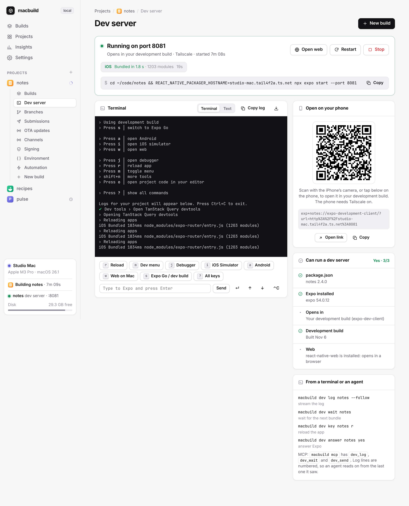
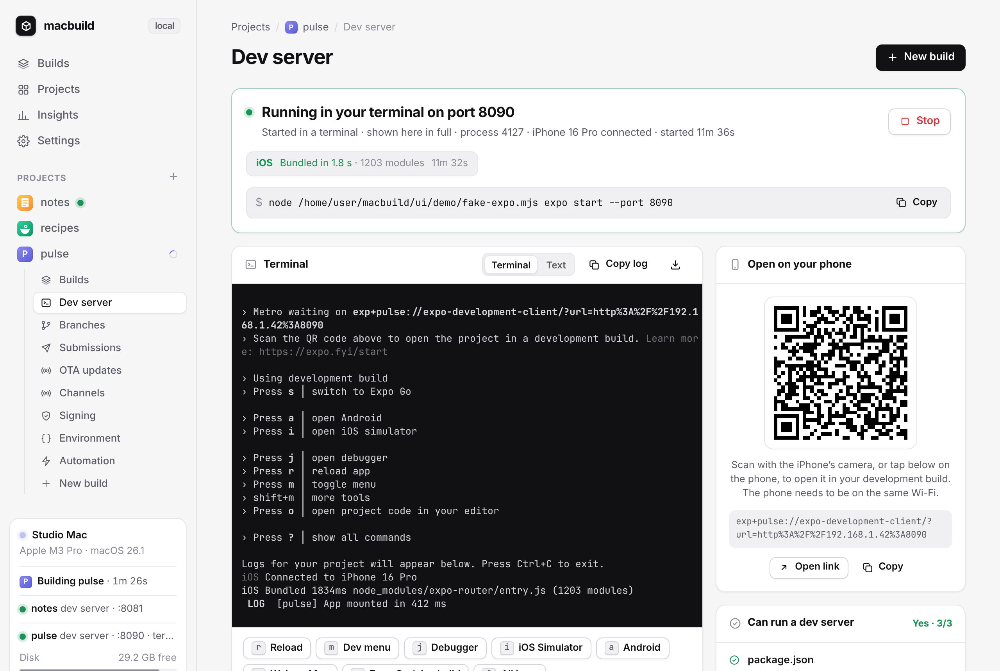

# Dev servers

[← README](../README.md)



Each project has a **Dev server** page. The dashboard runs `npx expo start` for the app on the Mac, in a terminal it holds, so you can start Metro from your phone and close the laptop. The projects page shows, for every app, whether it can run one and whether one is running.

- **Can it run?** The page checks that the app has `expo` in `package.json` and installed. If the dependencies are missing, it shows the install command for the app's package manager, at the workspace root in a monorepo. It also shows whether the app opens in a development build (`expo-dev-client`) or Expo Go, whether one has been built here, and whether it has web support.
- **How the phone reaches it:**
  - **Tailscale** (the default when it's on) puts the Mac's tailnet name in the link, so the phone can be anywhere.
  - **Same Wi-Fi** uses the Mac's local address.
  - **This Mac only** is for the Simulator, an emulator and web.
  - **Tunnel** goes through Expo's ngrok tunnel.
- **The command** is shown exactly as it runs, with a copy button: `npx expo start --port N` plus that one connection flag. Each app gets its own port, starting at 8081.
- **Open it.** Once Metro is ready, the page shows a QR code and the link for the phone. Apps with web support get **Open web**, and with **Open the web app when it's ready** ticked, a tab opens as soon as Metro is up.
- **Expo's terminal**, streamed live with colours. You can also switch to numbered plain text, copy the log or download it. Buttons press Expo's keys: reload, dev menu, debugger, iOS Simulator, Android, web, switch to Expo Go, all keys. A box sends typed text.
- **Questions from Expo** appear above the terminal as buttons: Yes and No, or one button per option in a list. This covers installing ngrok for a tunnel and the tools menu.
- **Bundles** show per platform: progress while Metro bundles, then the time and module count, or a failure and the last error.

**Started one yourself?** Keep running `npx expo start` (or `npm start`, `yarn expo start`) in your own terminal. With one line in the app's `metro.config.js`, the dashboard shows that whole terminal: Expo's output, the QR code, its questions, every key. Keys and answers from the dashboard reach Expo as if you'd typed them, and your terminal works exactly as before. You can stop it from the dashboard; restart it in your terminal.



```js
try { require('@fav-devs/macbuild/metro').attach(); } catch {}
```

Add it with **Add to metro.config.js** on the Dev server page, `macbuild dev hook myapp`, or the optional fix in setup. Each one asks first. If the app has no `metro.config.js`, one is created with Expo's defaults.

How it works:

- **Loading:** Expo loads `metro.config.js` inside the `expo start` process, which is how the hook gets in.
- **Finding macbuild:** the installer links macbuild into `~/.node_modules`, one of Node's own lookup folders, so the line works on your Mac without a dependency in the app. If you'd rather declare it, `npm install -D @fav-devs/macbuild` works too.
- **Everywhere else** (teammates, CI, EAS builds, `expo export`) the `require` fails quietly, or the hook sees it isn't `expo start` with the dashboard running, and nothing changes.
- **Connection:** the hook talks to the dashboard over a socket in your home folder that only you can open. It reconnects if the dashboard restarts.
- **Limits:** the two lines Expo prints before it loads the config ("Starting project at…") don't show. A `metro.config.ts` has to be edited by hand.
- **Off switch:** `MACBUILD_ATTACH=0` turns the hook off.

Without the line, the dashboard still finds a dev server started in a project's folder within a few seconds. It follows Metro instead: bundles, your app's `console` output, the connected phone and the QR code. It can reload the app, open its dev menu or stop it. Expo's own output and other keys stay in your terminal, since another program can't read or type into it. **Run it here** stops it there and starts it in macbuild on the same port.

From a terminal or an agent, on the Mac or through a remote with the `dev` scope:

```sh
macbuild dev                         # every app: can it run, is it running, port and link
macbuild dev myapp --open            # start it, wait until Metro is ready, open the web app or link
macbuild dev myapp --lan --clear     # Same Wi-Fi, with Metro's cache cleared
macbuild dev log myapp --follow      # Expo's output as numbered lines
macbuild dev key myapp r             # press r (reload); also m, j, i, a, w, s, ?, enter, up, down, ctrl-c
macbuild dev answer myapp yes        # answer Expo's question: yes, no, or an option's number
macbuild dev wait myapp --since 120  # wait for the next bundle after line 120: exit 0 bundled, 1 failed, 124 timed out
macbuild dev stop myapp
macbuild dev hook myapp              # add macbuild's line to metro.config.js: npx expo start in a terminal shows in full
macbuild dev takeover myapp          # one started in a terminal without it: stop it there, run it here on the same port
macbuild dev myapp --here            # run expo start in this terminal instead, without the dashboard
```

`macbuild mcp` (and `macbuild --remote NAME mcp`) has the same operations as tools: `dev_servers`, `dev_status`, `dev_start`, `dev_stop`, `dev_log`, `dev_wait` and `dev_send`. Every log line has a number. An agent that edits code passes the last number it read to `dev_wait` and gets back the bundle that followed, or the error.

It's Expo's terminal, not a shell. Keys and text go to `expo start` and nothing else, and the command can't be changed from the page or the API. The dev servers macbuild runs stop when the dashboard stops or restarts. Ones started in your own terminal keep running, and the dashboard picks them up again when it's back. Each one keeps its last 20 logs in `~/.local/share/macbuild/dev`. The first time a phone connects over Tailscale or Wi-Fi, macOS may ask whether Node can accept incoming connections: allow it.
