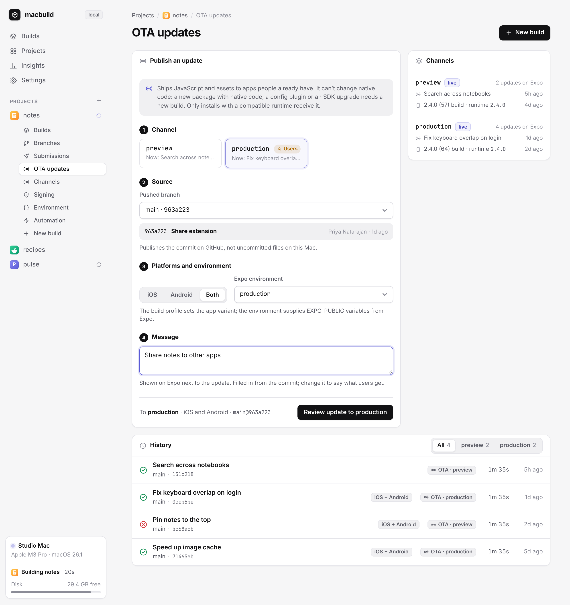

# OTA updates

[← README](../README.md)



Open a project and choose **Push OTA** (or **OTA updates** in its sidebar). Publishing takes four steps:

1. **Channel.** Each channel's card shows the update it has now. Production is marked, since that's where your users are.
2. **Source.** A pushed branch, with the commit that would ship: its hash, subject, author and age.
3. **Platforms and environment.** iOS, Android or both, and the Expo environment that supplies `EXPO_PUBLIC` variables.
4. **Message.** Filled in from the commit; change it to say what users get.

You review the update on the page before it goes out. A production update gets a warning-coloured confirmation that says who receives it and that it can't be taken back from phones that already have it.

Beside the form, **Channels** shows for each channel the last update from this Mac, the newest build that receives it and its runtime, and Expo's update count. Below, the history lists every publish with its commit and status, filterable by channel. Each OTA publish has its own live log. OTA and store uploads share a queue independent of local builds.

Agents and terminal users can publish the same way:

```sh
macbuild update parley --profile production --channel production \
  --environment production --platform ios --ref main \
  --message "Fix keyboard suggestions"
macbuild show parley
macbuild log parley
```

`macbuild ota` is an alias for `macbuild update`. A message, channel, and pushed `--ref` are required. The profile defaults to `production`; platform defaults to `all`. The Expo environment can be inherited from the profile or a standard channel name, but custom channels require an explicit environment. The chosen profile must declare the destination channel; its inherited `env` values supply app-variant settings. Expo environment variables are loaded with `eas update --environment`; ignored local `.env` files are not copied into OTA checkouts.

Publishing uses a separate checkout of a commit reachable from an origin branch, so uncommitted files do not ship and the original project is not modified. No native build or store submission runs. Projects need `expo-updates` configured and an installed release with a matching channel and compatible runtime. JavaScript and asset changes can ship OTA; native module, configuration, or runtime changes may require a new local build. A successful publish does not mean every installed app has already downloaded it. Stopping a publish does not roll back an update already accepted by Expo.

The CLI blocks until publication finishes and records the result in the same history used by `macbuild builds`, `show`, `log`, and the MCP read tools. For dashboard publishes, agents can use `macbuild wait <id>` rather than polling.
