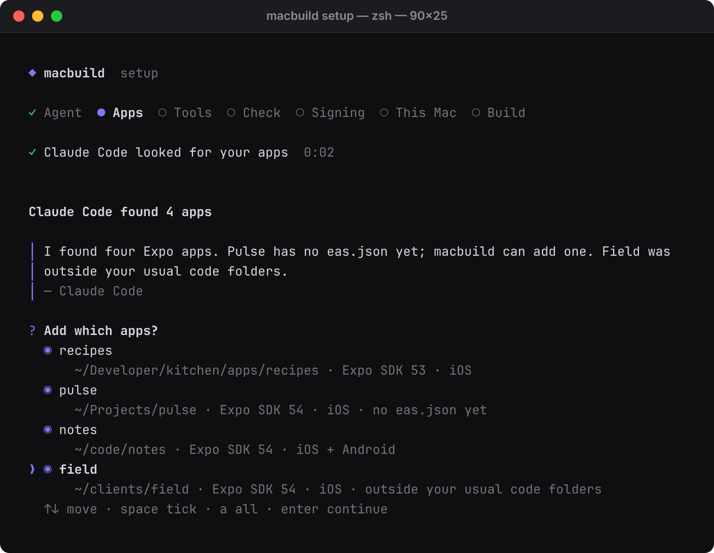
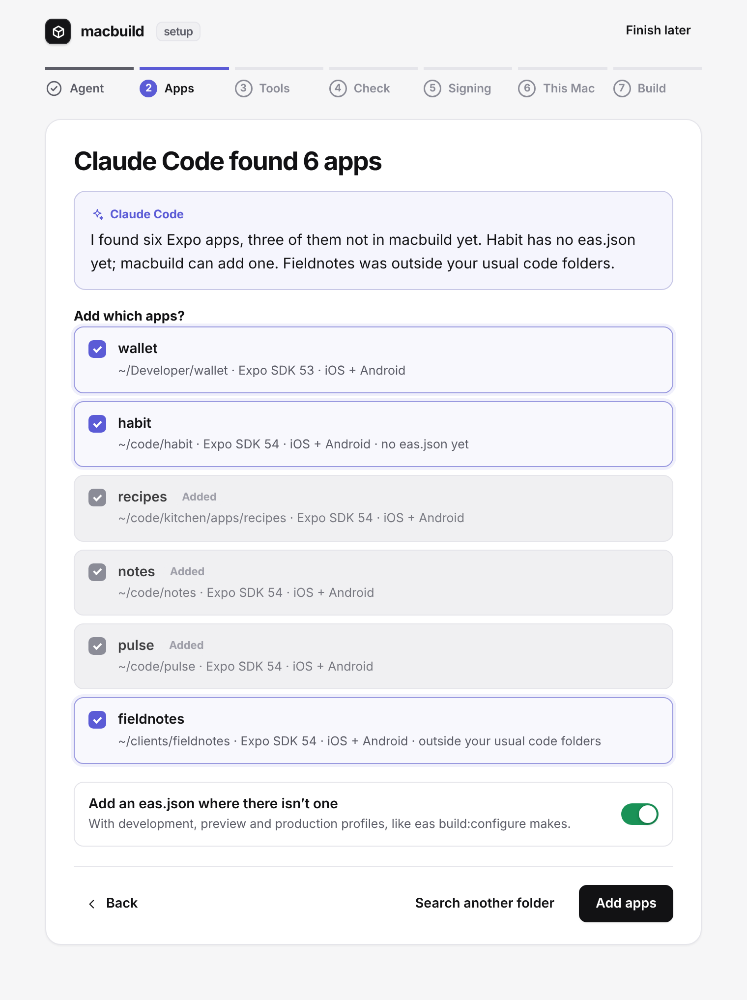

# First-time setup

[← README](../README.md)

In a terminal, the installer ends with the guided setup. It asks whether to carry on in the terminal or in the browser, then walks through eight steps:

<p>
  
  
</p>

1. **Agent.** Pick Claude Code or Codex if you have one. It works in the background, read-only: Claude Code gets only its Read, Glob and Grep tools, and Codex runs in its read-only sandbox. Both follow [the setup skill](skills/macbuild-setup/SKILL.md).
2. **Apps.** The agent looks for Expo and React Native apps, in your usual code folders and beyond, and reads each one. You tick the ones to add, or point it at another folder.
3. **Tools.** `macbuild doctor`, with the command for each missing tool ready to run.
4. **Check.** Anything that would make EAS stop and ask during a build: no bundle identifier, no EAS project, no development profile, no `expo-dev-client`. Each fix is listed for you to approve, with a suggested value you can change. macbuild makes the change, from a fixed list of fixes it knows; the agent never edits anything.
5. **Signing.** `eas credentials:configure-build` for each app, in a terminal, where you sign in to Apple yourself. macbuild and the agent never see your password.
6. **This Mac.** The dashboard at login, the iPhone for `--install` and your Apple ID.
7. **Phone.** Tailscale, so the dashboard opens on your phone and stays private to your tailnet: install it, sign in, and publish the dashboard with `tailscale serve`. Then a link and a QR code for your iPhone. Skip it to keep the dashboard on the Mac only.
8. **First build.** A development build of the app you pick.

Without an agent, macbuild's own scan and checks do steps 2 and 4. Setup remembers where you got to, in the terminal and the browser alike.

```sh
macbuild setup             # the guided setup: in this terminal, or in the browser
macbuild setup --cli       # straight to the terminal; --web for the browser
macbuild setup --agent codex   # pick the agent up front: claude, codex or none; --reset starts over
macbuild setup --status    # what's set up and what's missing, for scripts and agents
macbuild setup --ui        # dashboard + menu bar + Tailscale Serve
macbuild setup --tailscale # start Tailscale and publish the dashboard on the tailnet
macbuild setup --login     # open at login
macbuild setup --open      # open the setup page in the browser
```

The first time you run plain `macbuild`, it offers the same setup. In the browser it's the dashboard's `#/setup` page; if the dashboard isn't installed yet, `macbuild setup --web` serves it until you finish, then installs it if you asked for that.
